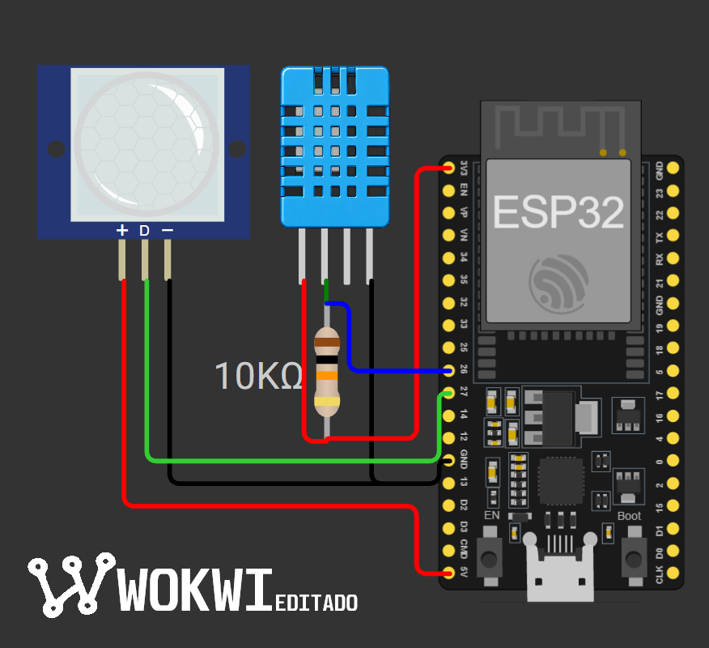
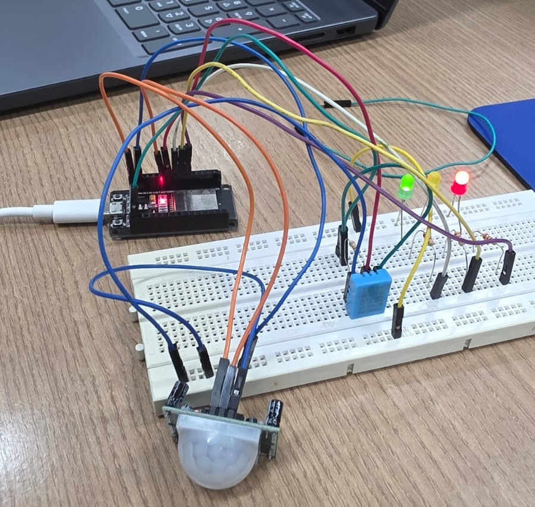
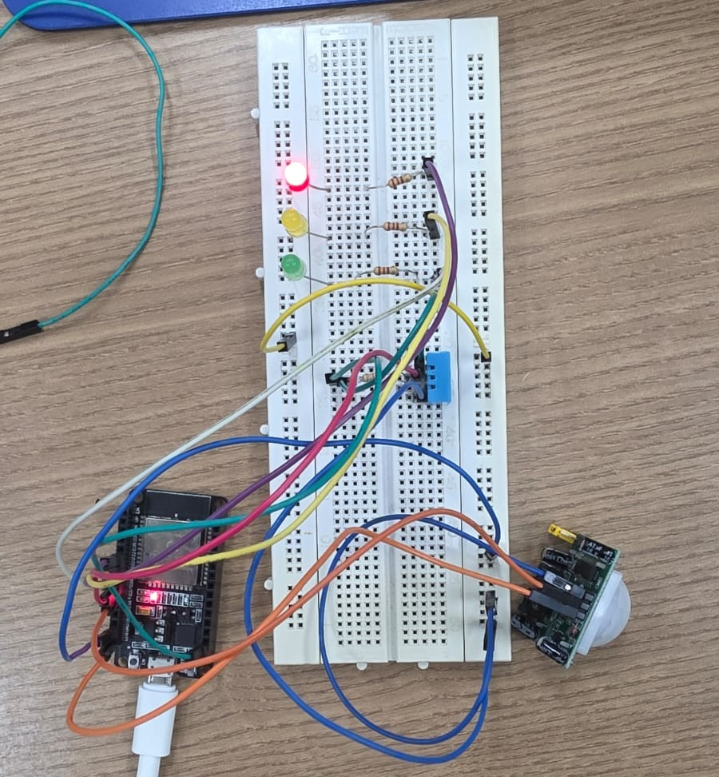
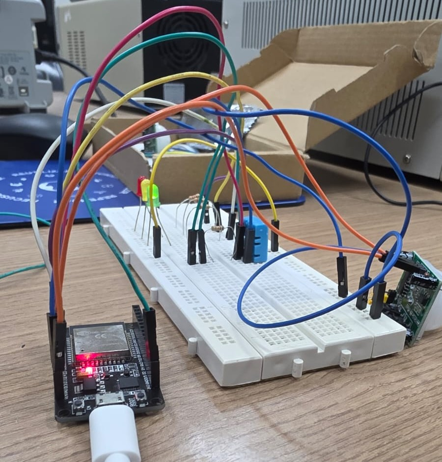
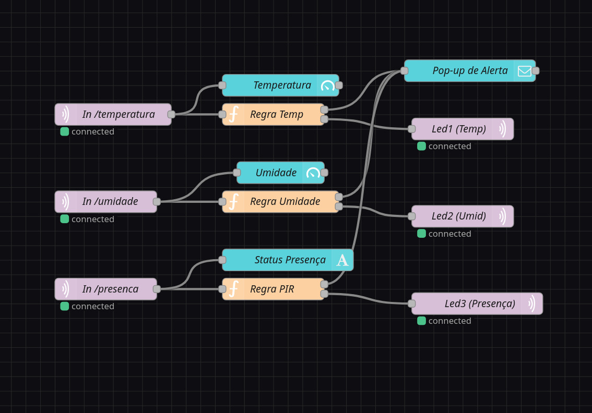
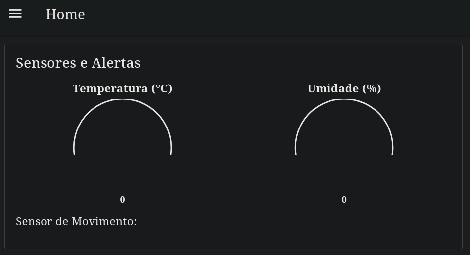
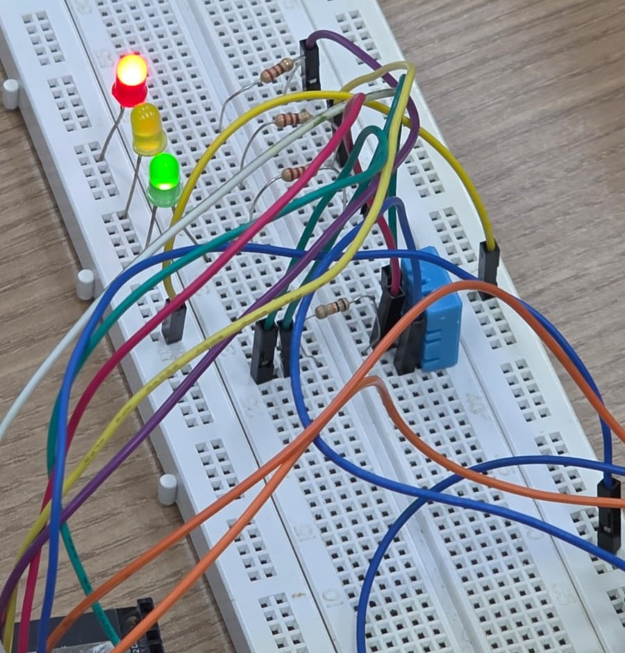
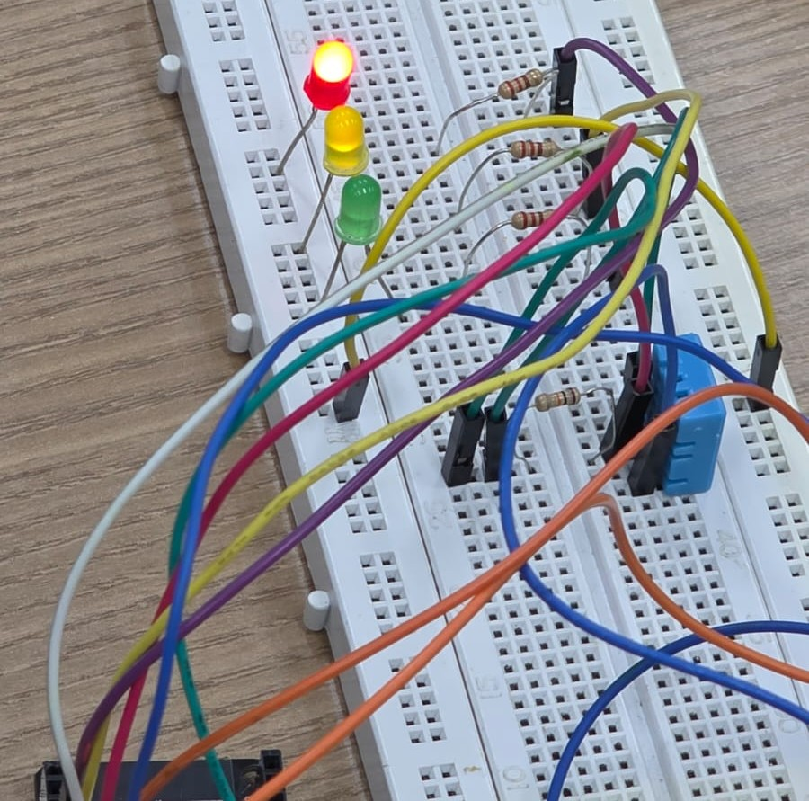
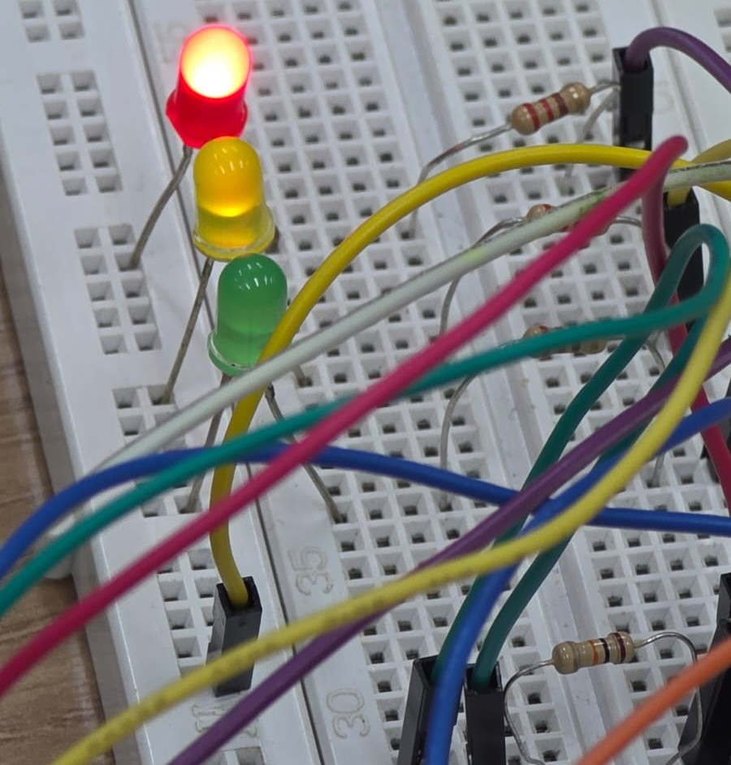

## Plataformas de Hardware para Internet das Coisas
### Docente: Daniel Lopes Martins 
### Discentes: 
- Davi Vieira de Carvalho lima
- Leandro Antony Batista Lemos
- Mariana Jamile dos Santos Ferreira
- Vinicius Costa Soares

# ESP32: Comunicação de dados DHT11 e HC-SR501 para projeto de fluxo Node-Red via MQTT

Projeto de laboratório para ESP32 que combina **leitura de dados**, **criação de Tasks**, **conexão Wi-Fi**, **comunicação via protocolo MQTT** e **controle de fluxo no `Node-Red`** em um único Projeto. O ESP32 realiza a leitura dos sensores **HC-SR501** e **DHT11** através de **Tasks** individuais criadas para uma medição assíncrona, e que com base nos dados obtidos, publica os dados em um tópico específico via protocolo **MQTT** para um broker, o **Node-Red** devidamente configurado e inscrito nos tópicos recebe os dados, faz a análise e toma uma decisão de criar um alerta sobre o dado de **temperatura**, **umidade** ou **movimento detectado**, emitindo um alerta no dashboard do Node-Red e enviando `0/1` de volta para o broker para que o ESP32 possa receber a ação a tomar, se deve acender o LED ou não correspondente ao alerta.  

Link para vídeo demonstrativo no youtube: https://www.youtube.com/watch?v=DWntVKF-mXs

## Sumário

- [Funcionalidades](#funcionalidades)
- [Materiais](#materiais)
- [Mapeamento de pinos](#mapeamento-de-pinos)
- [Esquema de ligação](#esquema-de-ligação)
- [Diagrama do circuito](#diagrama-do-circuito)
- [Como funciona](#como-funciona)
- [Fotos](#fotos)
- [Como compilar e gravar](#como-compilar-e-gravar)
- [Saída serial](#saída-serial)
- [Problemas enfrentados](#problemas-enfrentados)
- [Parâmetros configuráveis](#parâmetros-configuráveis)
- [Estrutura do repositório](#estrutura-do-repositório)

## Funcionalidades

- Realiza a leitura das variáveis de temperatura, umidade e movimento nos `PIN_DHT` e `PIN_PIR`.
- Publica os dados para o broker via `MQTT` nos tópicos específicos.
- Node-Red inscrito nos tópicos lê os dados publicados e checa se **temperatura ** está abaixo de 20°C ou maior ou igual a 25°C, se **umidade** está acima de 60% e se o dado de leitura do HC-SR501 é 1 ou 0 (movimento detectado ou não).
- Caso condição satisfeita, o controle de fluxo publica em um tópico específico que o ESP32 está inscrito uma informação booleana para ligar o LED de alerta respectivo.
-  O ESP32 lẽ os dados publicados e executa o comando devido de ligar ou desligar os LEDs de alerta.
- Para *debugging*, é feita uma exibição no monitor serial (baud 115200) das leituras dos sensores e dos dados recebidos nos respectivos tópicos.

## Materiais

| Qtd | Componente |
|-----|------------|
| 1 | Placa ESP32 (WROOM 32) |
| 1 | Sensor de movimento HC-SR501 |
| 1 | Sensor de temperatura e umidade DHT11 |
| 3 | LED's de cores preferencialmente distintas |
| 1 | Resistor 10 kΩ |
| 3 | Resistor 220 Ω |
| Quanto necessário | Protoboard e jumpers |

## Mapeamento de pinos

| Função | GPIO | Tipo | Observação |
|--------|------|------|------------|
| `Output HC-SR501` | 27 | Saída digital | Saída 3,3v (**datasheet**) |
| `VCC` do HC-SR501 | 5V / VIN | Alimentação | O HC-SR501 opera em 5 V |
| `Data` | 26 | Saída digital | Saída 3,3v |
| `VCC` do DHT11 | 3,3V | Alimentação | O DHT11 pode operar em 3,3V (**datasheet**) |
| `LED_temperatura` | 32 | Saída digital | Saída 3,3v |
| `LED_umidade` | 33 | Saída digital | Saída 3,3v |
| `LED_HC-SR501` | 25 | Saída digital | Saída 3,3v |
| `GND` | GND | Terra comum | Sensor, divisor e ESP32 |

### Diagrama do circuito


(Fonte: Wokwi editado)

### Fotos

- Circuito montado





- Node-Red diagrama de fluxos



- Node-Red dashboard



- LED states





## Como compilar e gravar

### Configuração da `main.c`

Para realizar a execução adequada do código, é necessário que você faça a configuração de acordo com a sua rede e com o broker que deseja se comunicar. Para isso, no arquivo da `main.c`, preencha dentro das aspas duplas com suas informações:

- Configuração da conexão

1. Na linha 29 insira o nome da sua rede; 
2. Na linha 30 insira a senha da rede;
3. Na linha 32 insira o IP do broker em IP_ADDRESS e a porta da comunicação no PORT;
4. Na linha 33 insira o username para a comunicação MQTT;
5. Na linha 34 insira a senha para a comunicação MQTT;
6. Na linha 35 insira o ID do cliente para a comunicação MQTT;

- Configuração dos tópicos de leitura do ESP32

1. Na linha 37, insira o seu tópico para o ESP32 ler os dados vindos do broker para decidir se liga ou desliga o led de temperatura;
2. Na linha 38, insira o seu tópico para o ESP32 ler os dados vindos do broker para decidir se liga ou desliga o led de umidade;
3. Na linha 39, insira o seu tópico para o ESP32 ler os dados vindos do broker para decidir se liga ou desliga o led de movimento detectado;

- Configuração dos tópicos de publicação do ESP32

1. Na linha 42, insira o seu tópico para o ESP32 publicar os dados de temperatura para o broker.
2. Na linha 43, insira o seu tópico para o ESP32 publicar os dados de umidade para o broker.
3. Na linha 44, insira o seu tópico para o ESP32 publicar os dados de movimento para o broker.

### Configuração do Node-Red

Dentro do Node-Red você irá importar o projeto de fluxo em `node-red_flow/flows.json` e configurar o broker com o qual ele irá se conectar e os nomes dos tópicos de inscrição e de publicação de acordo com o broker que você inseriu na `main.c` e com base nos de publicação e inscrição da `main.c`, você faz os tópicos de inscrição e publicação do node-red.

- Lembrando que o node-red se inscreve nos tópicos que o ESP32 vai publicar e o node-red vai publicar nos tópicos que o ESP32 está inscrito.

### ESP IDF

1. Realize a instalação da plataforma ESP IDF na sua máquina.
2. Rode no terminal:
   1. `idf.py` `set-target` `SUA_PLACA (Ex: esp32)`
   2. `idf.py` `build`
   3. `idf.py` `--port` `PORTA` `flash` `monitor`

Após compilado, código em funcionamento e conexão estabelecida, basta checar se as informações estão sendo comunicadas.

## Saída serial

Certifique de que o monitor serial está configurado para **115200 baud**. Serão impressas as informações de conexão IP do ESP32 na rede, status da conexão e se a conexão com o broker MQTT foi estabelecida.

## Problemas enfrentados

Um problema enfrentado foi com diferentes ambientes de rede no qual o ESP32 tentava se conectar. Ao depender da sua rede, o seu modo de autenticação pode variar. A solução para esse problema está na alteração da linha 236 da `main.c` para inserção do modo de autenticação usado na sua rede.

## Parâmetros configuráveis

| Constante | Valor | Descrição |
|-----------|-------|-----------|
| `PIN_PIR` | GPIO_NUM_27 | Pino de leitura do sensor `HC-SR501` |
| `PIN_DHT` | GPIO_NUM_26 | Pino de leitura do sensor `DHT11` |
| `PIN_LED_TEMP` | GPIO_NUM_32 | Pino de escrita do LED de temperatura |
| `PIN_LED_UMID` | GPIO_NUM_33 | Pino de escrita do LED de umidade |
| `PIN_LED_PIR` | GPIO_NUM_25 | Pino de escrita do LED de movimento |
| `WIFI_SSID` | Nome da sua rede | Nome da rede que o ESP32 irá tentar conexão |
| `WIFI_PASS` | Senha da sua rede | Senha da rede que o ESP32 irá tentar conexão |
| `MQTT_URI` | Endereço do broker MQTT | Endereço do broker que o ESP32 irá tentar conexão |
| `MQTT_USER` | Nome de usuário para MQTT | Nome de usuário do ESP32 terá na conexão |
| `MQTT_PASS` | Senha de usuário para MQTT | Senha de usuário do ESP32 terá na conexão |
| `TOPIC_LEDtemp` | Tópico do LED de temperatura | Tópico em que o ESP32 irá se inscrever e ler os comandos para o alerta de temperatura |
| `TOPIC_LEDumid` | Tópico do LED de umidade | Tópico em que o ESP32 irá se inscrever e ler os comandos para o alerta de umidade |
| `TOPIC_LEDpir` | Tópico do LED de movimento | Tópico em que o ESP32 irá se inscrever e ler os comandos para o alerta de movimento |
| `TOPIC_TEMP` | Tópico de temperatura | Tópico em que o ESP32 irá publicar os dados de leitura de temperatura |
| `TOPIC_UMID` | Tópico de umidade | Tópico em que o ESP32 irá publicar os dados de leitura de umidade |
| `TOPIC_PIR` | Tópico de movimento | Tópico em que o ESP32 irá publicar os dados de leitura de movimento |

## Estrutura do repositório

```
.
├── CMakeLists.txt
├── dependencies.lock
├── images
│   └── [...]
├── main
│   ├── CMakeLists.txt
│   ├── idf_component.yml
│   └── main.c
├── node-red_flow
│   └── flows.json
└── README.md
```
